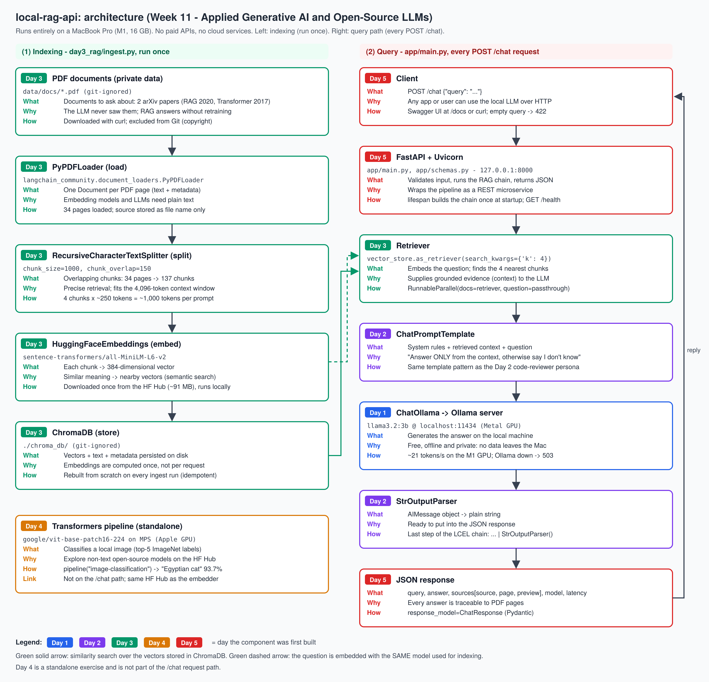
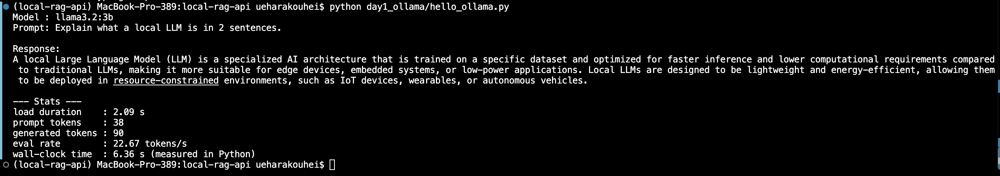
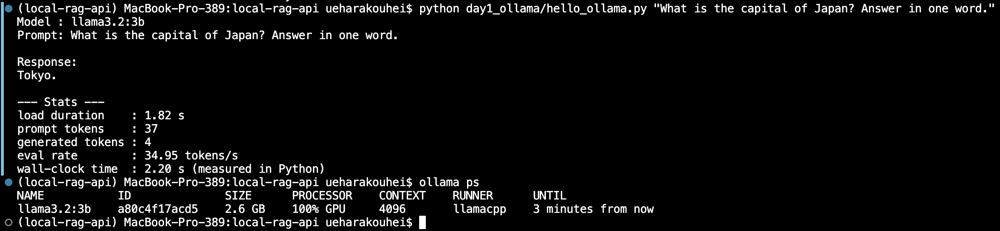
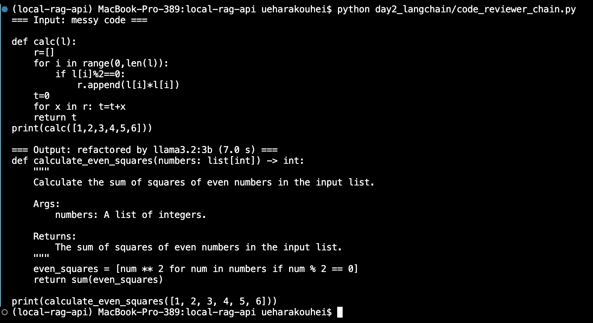
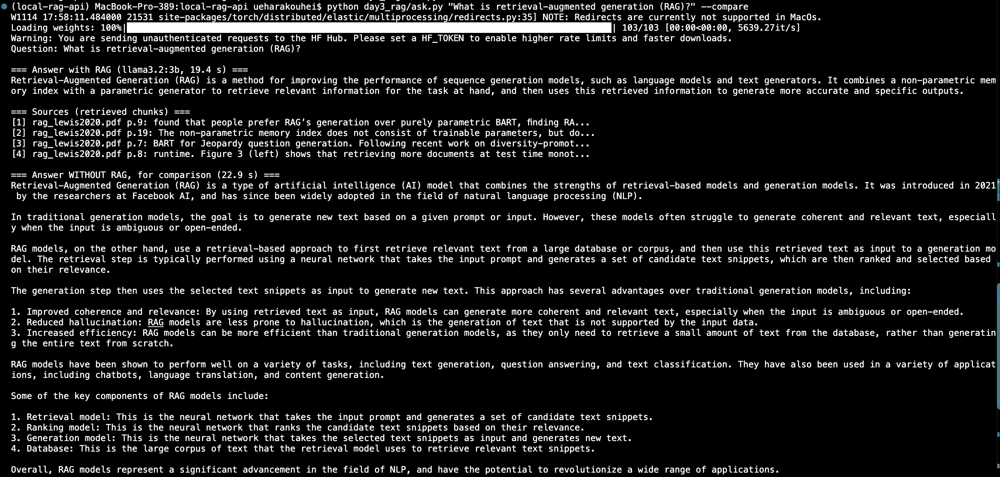
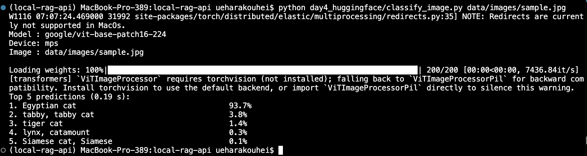
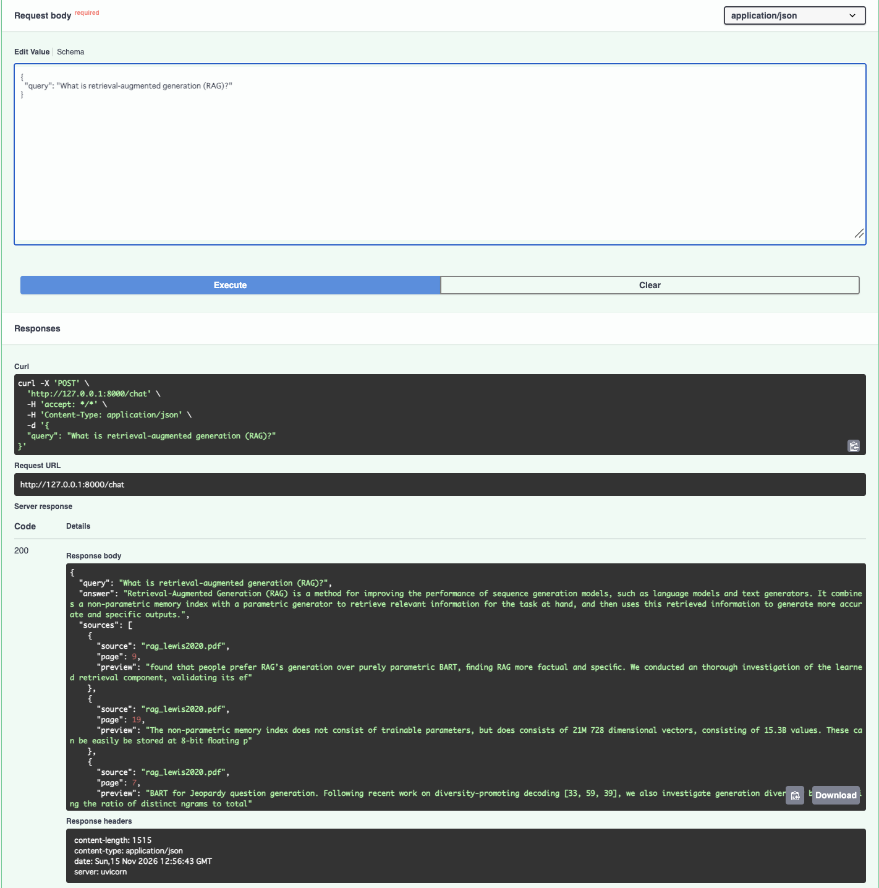

# local-rag-api

A fully local **Retrieval-Augmented Generation (RAG) microservice** built only with free, open-source tools.
Ask questions about your own PDFs through a REST API: no paid APIs, no cloud services, and it keeps working with Wi-Fi turned off.

> Prime One Global — ML Engineer Internship, Week 11: Applied Generative AI and Open-Source LLMs



## Highlights

- **Local LLM**: `llama3.2:3b` served by Ollama on the Apple M1 GPU (Metal), about 21 tokens/s
- **RAG over private PDFs**: PyPDFLoader → text splitter → `all-MiniLM-L6-v2` embeddings → ChromaDB
- **Grounded answers with sources** (file name + page), and an honest "I don't know" when the documents do not contain the answer
- **FastAPI microservice**: `POST /chat` with Pydantic validation, `GET /health`, and clear `422` / `503` errors
- **Hugging Face Transformers pipeline** for image classification (Vision Transformer) on the Apple GPU

## Tech Stack

| Layer | Tool |
|---|---|
| Local LLM runtime | Ollama 0.40 (`llama3.2:3b`; `llama3.1:8b` for comparison) |
| Orchestration | LangChain 1.5 (LCEL: `prompt \| llm \| parser`) |
| Embeddings | sentence-transformers `all-MiniLM-L6-v2` (384 dimensions) |
| Vector store | ChromaDB (persisted to `./chroma_db`) |
| Vision model | Hugging Face Transformers `google/vit-base-patch16-224` |
| API | FastAPI + Uvicorn, Pydantic |
| Environment | macOS on Apple Silicon (M1, 16 GB), conda, Python 3.11 |

## Project Structure

```
local-rag-api/
├── app/                       # Day 5: FastAPI microservice
│   ├── main.py                #   endpoints, startup (lifespan), error handling
│   ├── rag.py                 #   RAG chain ported from day3_rag/ask.py
│   └── schemas.py             #   Pydantic request/response models
├── day1_ollama/
│   └── hello_ollama.py        # Day 1: call the local model from Python
├── day2_langchain/
│   └── code_reviewer_chain.py # Day 2: prompt | llm | parser chain
├── day3_rag/
│   ├── rag_config.py          # shared settings (paths, models, chunking)
│   ├── ingest.py              # PDFs -> chunks -> embeddings -> ChromaDB
│   └── ask.py                 # question -> retrieval -> grounded answer
├── day4_huggingface/
│   └── classify_image.py      # Day 4: image classification with a pipeline
├── data/
│   ├── docs/                  # your PDFs (git-ignored)
│   └── images/                # your sample images (git-ignored)
├── docs/                      # architecture diagram and screenshots
└── requirements.txt
```

## Setup

Requirements: macOS on Apple Silicon (tested on MacBook Pro M1, 16 GB), the [Ollama](https://ollama.com) app, and conda (Miniconda).

```bash
git clone https://github.com/Kohei-Uehara-VIP/local-rag-api.git
cd local-rag-api

ollama pull llama3.2:3b

conda create -n local-rag-api python=3.11 -y
conda activate local-rag-api
python -m pip install -r requirements.txt
```

PDFs are not included in this repository (copyright). The demo used two arXiv papers:

```bash
curl -L -o data/docs/rag_lewis2020.pdf https://arxiv.org/pdf/2005.11401
curl -L -o data/docs/attention_vaswani2017.pdf https://arxiv.org/pdf/1706.03762
```

## Day 1 — Run a Local LLM with Ollama

```bash
ollama run llama3.2:3b --verbose          # chat in the terminal with timing stats
python day1_ollama/hello_ollama.py        # call the model from Python
python day1_ollama/hello_ollama.py "What is the capital of Japan? Answer in one word."
```

Measured on MacBook Pro (M1, 16 GB), same prompts for both models:

| Model | Download size | Generation speed |
|---|---|---|
| `llama3.2:3b` | 2.0 GB | ~21 tokens/s |
| `llama3.1:8b` | 4.9 GB | ~10 tokens/s |

- `llama3.2:3b` was chosen as the main model: about 2x faster, which matters for an interactive API, and RAG supplies the facts from the documents.
- Cold start (loading the weights into memory) took about 2 s; while the model stays loaded (about 5 minutes), it is almost 0 s.
- Verified to work fully offline (Wi-Fi turned off), running on the GPU (`ollama ps` shows `100% GPU`).




## Day 2 — LLM Orchestration with LangChain

```bash
python day2_langchain/code_reviewer_chain.py
```

An LCEL chain `ChatPromptTemplate | ChatOllama | StrOutputParser | extract_code` with a "Senior Python Code Reviewer" persona.
It refactors messy Python code while keeping its behavior, and strips the Markdown code fence so the output is ready to save or run.



## Day 3 — Local RAG Pipeline

```bash
python day3_rag/ingest.py                 # build the vector database (run once)
python day3_rag/ask.py "How many attention heads does the base Transformer model use?"
python day3_rag/ask.py "What is retrieval-augmented generation (RAG)?" --compare
```

- **Indexing**: 34 pages → 137 chunks (`chunk_size=1000`, `chunk_overlap=150`), embedded and stored in ChromaDB.
- **Querying**: the 4 most similar chunks are added to the prompt; the model must answer **only** from that context.

| Question | Answer with RAG | Sources |
|---|---|---|
| How many attention heads does the base Transformer model use? | 8 heads, each of dimension 64 (correct) | `attention_vaswani2017.pdf` p.5, p.3, p.1 |
| What is the capital of France? | "I don't know based on the provided documents." (correctly refuses) | unrelated chunks |
| What is retrieval-augmented generation (RAG)? | Combines a non-parametric memory index with a parametric generator | `rag_lewis2020.pdf` p.9, p.19, p.7, p.8 |

Without RAG, the same model claimed that RAG was "introduced in 2021" (the paper is from 2020) and invented a "ranking model" component.
With RAG, the answer follows the paper and can be traced back to specific pages.



## Day 4 — Exploring the Hugging Face Ecosystem

```bash
python day4_huggingface/classify_image.py data/images/sample.jpg
```

`google/vit-base-patch16-224` (a Vision Transformer fine-tuned on ImageNet-1k) found on the Hugging Face Hub, run locally with `pipeline("image-classification")` on the Apple GPU (MPS).
On a photo of two cats, the top prediction was **Egyptian cat (93.7%)**, and all top-5 labels were cat breeds. The sample image comes from the COCO dataset and is not included in this repository.



## Day 5 — GenAI Microservice with FastAPI

Start the server (keep the Ollama app running):

```bash
python day3_rag/ingest.py                 # only if chroma_db/ does not exist yet
uvicorn app.main:app --port 8000
```

Open the interactive docs at http://127.0.0.1:8000/docs, or call the API with curl:

```bash
curl -X POST http://127.0.0.1:8000/chat \
  -H "Content-Type: application/json" \
  -d '{"query": "How many attention heads does the base Transformer model use?"}'
```

Example response (shortened):

```json
{
  "query": "How many attention heads does the base Transformer model use?",
  "answer": "The Transformer model uses 8 parallel attention layers, or heads, with each head having a dimension of 64.",
  "sources": [
    {"source": "attention_vaswani2017.pdf", "page": 5, "preview": "output values. These are concatenated and once again projected, ..."}
  ],
  "model": "llama3.2:3b",
  "latency_seconds": 8.03
}
```

| Situation | Response |
|---|---|
| Empty or whitespace-only query | `422` validation error (Pydantic) |
| Ollama app is not running | `503` "Cannot reach the Ollama server. Is the Ollama app running?" |
| Vector database not built | `503` "No vector database found. Run `python day3_rag/ingest.py` first." |
| Health check | `GET /health` → `{"status": "ok", "rag_ready": true, ...}` |



## Design Decisions

- **Ollama runs natively, not in Docker**: Docker on macOS cannot use the M1 GPU (Metal), so the model would run on the CPU only.
- **No sign-in to Ollama cloud features**: prompts and documents never leave the machine.
- **One shared config (`day3_rag/rag_config.py`)**: indexing and querying must use the same embedding model, otherwise the vectors cannot be compared.
- **The chain is built once at startup (`lifespan`)**: loading the embedding model and opening ChromaDB takes seconds, so it is not repeated per request.
- **`/chat` is a plain `def`**: the RAG chain is blocking, so FastAPI runs it in a worker thread instead of blocking the event loop.
- **Sources are returned with every answer**: RAG reduces hallucinations but does not remove them, so users can check the evidence.

## Differences from the Assignment Brief

| Brief | This project | Reason |
|---|---|---|
| `ollama run llama3` | `llama3.2:3b` (+ `llama3.1:8b` for comparison) | Newer generation; the 3B model fits the 16 GB machine comfortably |
| `pip install langchain langchain-community` | also `langchain-ollama` (`ChatOllama`) | The official Ollama integration now lives in its own package |
| A retrieval chain helper | LCEL (`RunnableParallel(...).assign(...)`) | Legacy chain helpers moved to `langchain-classic` in LangChain v1 |
| `pip install transformers torch` | also `pillow` (no `torchvision`) | Pillow loads the image; Transformers falls back to its PIL image processor |
| Python virtual environment | conda environment | Same isolation, consistent with the previous projects |

## Limitations and Next Steps

- A 3B model can still make small mistakes (for example, "Retrieval-Augmented *Generator*"); a larger model or a reranker would improve quality.
- The retriever always returns `k` chunks, even for unrelated questions; a similarity threshold would filter them.
- `langchain-community` is being sunset; `PyPDFLoader` should move to a standalone package.
- The API is stateless (no conversation history); a session store would enable follow-up questions.
- Containerize the API with Docker while keeping Ollama native (reachable via `host.docker.internal`).
